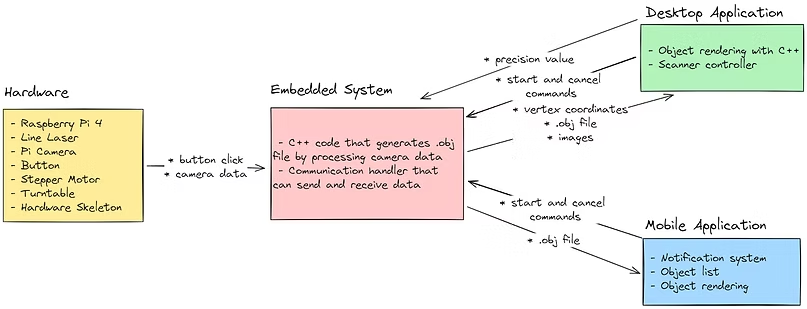

# 3D Laser Scanner with Image Processing and Rendering  

## 🧭 Overview

This project implements a **3D laser scanner** system combining hardware, embedded software, image processing, and multi-platform applications (desktop and mobile).  
The system scans a physical object by projecting a laser line, capturing images, processing them to extract 3D points, and rendering the result as a 3D model.

The repository contains code for multiple components of the system:  
- Embedded control (Raspberry Pi)  
- Image processing  
- Desktop rendering (Qt + OpenGL)  
- Mobile control (Flutter)  

More details are available on the project website:  
👉 [3D Laser Scanner Project Website](https://99ayyldzbaris99.wixsite.com/3d-laserscanner/about)

---

## ⚙️ System Architecture

The project is composed of **four main modules**:

### 1. Hardware Module
- Enclosure made from **wooden chipboard**, painted black inside to reduce reflections.  
- **Stepper motor (28BYJ-48)** controls object rotation via GPIO pins on Raspberry Pi (1, 7, 8, 25).  
- **Raspberry Pi 4B** coordinates stepper control, image capture, and communication.  
- **Line laser** mounted on a 3D-printed holder projects a vertical laser line.  
- **Camera** (Raspberry Pi Camera Module) captures images of the laser-illuminated object.  
- **Button & LEDs** provide user feedback:  
  - Blue LED = ready  
  - Red LED = scanning  
  - Pressing the button toggles scanning state  

---

### 2. Embedded System & Image Processing
- Uses **OpenCV (C++)** for image processing.  
- Crops captured images using calibration points.  
- Two algorithms were tested for laser detection:  
  - Early version: red mask and leftmost region (noise-sensitive)  
  - Final version: select the brightest red pixel per line, then fill missing points vertically (more stable)  
- Converts extracted 2D data into 3D points using **cylindrical coordinates**.  
- Generates `.obj` files with vertex (`v`), texture (`vt`), and face (`f`) data.  
- Uses multithreading to handle operations:  
  - `mainThread`: accepts client connections (desktop/mobile)  
  - `handleClient`: processes messages  
  - `mainScanner`: performs the actual scanning  
  - `buttonListener`: monitors physical button events  
- Streams live data and images to clients while scanning.

---

### 3. Desktop Application (Qt + OpenGL)
- Developed using **Qt 6.5**, **OpenGL**, and **C++17**.  
- Provides multiple pages for control, visualization, and analysis:

#### 🖥️ Features
- **3D Render Page:**  
  - Renders `.obj` models using `QOpenGLWidget` and `QOpenGLFunctions`.  
  - Uses **Assimp** (model import), **glm** (math), **stb_image** (textures).  
  - User controls: orbit, zoom, pan, toggle wireframe, view stats (vertices, faces, volume, area).  
- **Charts / Data Page:**  
  - Real-time scanning progress using `QChartView` and `QSplineSeries`.  
  - Displays rotation count, scan percentage, current angle, point count, and elapsed time.  
- **Point Cloud Page:**  
  - Displays 3D scatter of captured points (`Q3DScatter`) during scanning.  
- **Captured Images Page:**  
  - Shows raw and processed images side by side.  
- **Calibration Page:**  
  - Fetches image from Raspberry Pi, allows user to select crop coordinates, and sends calibration back.  
- **Connection Page:**  
  - Establishes connection to Raspberry Pi via IP address.

---

### 4. Mobile Application (Flutter)
- Developed with **Flutter** (Dart).  
- Enables remote control of the scanner from a smartphone.

#### 📱 Main Features
1. Connect to embedded system via IP  
2. Start or cancel scan  
3. View live progress and status messages  
4. Save or discard completed scans  
5. Browse scan history and view saved `.obj` files  
6. Recolor object (light/dark mode)  
7. Reset view position  
8. Export or delete saved models  

---

